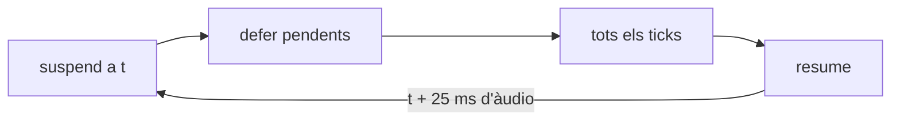

# Trama — Exportar l'àudio sense temps real

3 d'octubre de 2026

Pla per desar el so d'una peça en un fitxer sense haver-la de sentir sencera:
un botó **Export** que renderitza la cançó amb un `OfflineAudioContext`, molt
més ràpid que el temps real, i en baixa un `.wav`. El botó ● continua gravant
en directe com ara.

## Abast

- **Entra:** tot el que el patch i la cançó ja tenen escrit: mòduls, cables,
  patrons, seqüenciadors, clips, automàtiques de knobs i faders, i el Fade
  final.
- **Queda fora:** el que només existeix en directe: Audio Input (micròfon),
  teclat de l'ordinador, MIDI d'entrada i knobs moguts durant l'export.
- **Només en mode cançó, i sense loop.** En mode patró no hi ha res a
  exportar. Amb el loop activat la cançó no s'acaba, i l'export queda
  desactivat fins que es decideixi quantes voltes fa el loop.

## Estat actual

Hi ha un sol `AudioContext`, creat a `src/main.tsx:16`, i tot el temps musical
surt de temporitzadors del fil principal que llegeixen `context.currentTime`.
Una part del camí ja està feta: `Transport`, `SongPlayer`, `StepClock`,
`OutputModule`, `loadWorklets` i `SampleLibrary.decode` ja reben un
`BaseAudioContext`.

| Peça                     | On                                                                                                     | Què fa ara                                                                                                                | Lligam al temps real                                           |
| ------------------------ | ------------------------------------------------------------------------------------------------------ | ------------------------------------------------------------------------------------------------------------------------- | -------------------------------------------------------------- |
| Gravació                 | `RecordButton.tsx:45`, `AudioEngine.ts:129`                                                            | `MediaRecorder` sobre un `MediaStreamAudioDestinationNode` on van tots els Output                                         | `createMediaStreamDestination` només existeix a `AudioContext` |
| Motor                    | `AudioEngine.ts:102`, `:124`, `:157-203`                                                               | Tipat com a `AudioContext`; `start`/`stop` fan `resume`/`suspend` i escolta `statechange`                                 | Tipus i cicle de vida                                          |
| Cançó                    | `SongPlayer.ts:95`                                                                                     | `setInterval` de 25 ms que programa 0,1 s endavant: llança patrons mig compàs abans, automàtiques i Fade, i crida `onEnd` | Temporitzador de rellotge de paret                             |
| Passos                   | `StepClock.ts:103`                                                                                     | `setInterval` de 25 ms, 0,1 s endavant; si fa tard, salta a ara en lloc de recuperar                                      | Temporitzador, i la regla de saltar                            |
| Arrencada dels rellotges | `ClockModule`, `SampleHoldModule`, `ArpeggiatorModule`, `DrumsModule`, `SequencerModule`, `ClipModule` | `setTimeout` per engegar el `StepClock` en crear el mòdul                                                                 | Temporitzador curt                                             |
| Mostres                  | `SampleLibrary.decode`                                                                                 | `decodeAudioData` asíncron                                                                                                | Cal esperar-lo abans de renderitzar                            |
| Micròfon                 | `AudioInputModule.ts:81`                                                                               | `getUserMedia` + `createMediaStreamSource`                                                                                | Només en directe                                               |

Els 15 worklets no envien res al fil principal, i les portes entre mòduls
(`gateOn`/`gateOff`) són crides amb un temps d'àudio. Així, tot es programa
de la mateixa manera: un tick mira `currentTime` i programa el que cau dins de
la finestra.

## Obstacles

1. **Els temporitzadors no segueixen el render.** Un `OfflineAudioContext`
   avança tan de pressa com pot: en 25 ms de rellotge de paret poden passar
   segons d'àudio. Els ticks de `SongPlayer` i `StepClock` arribarien tard,
   `StepClock` saltaria passos per la seva regla de no recuperar, i la cançó es
   perdria compassos.
2. **El motor depèn d'`AudioContext`.** `resume()` abans de `startRendering()`
   falla en un context offline, `statechange` no hi té el mateix sentit i
   `createMediaStreamDestination` no hi existeix.
3. **La durada s'ha de saber abans.** Un `OfflineAudioContext` es crea amb un
   nombre de mostres fix, però avui la cançó només sap que s'acaba quan
   `nextBar` torna `undefined` en ple tick. I la cua s'ha d'allargar fins que
   el so baixi de -60 dB, cosa que no se sap fins que s'ha renderitzat.
4. **Les mostres arriben tard.** Si el render comença abans que el sampler
   tingui l'`AudioBuffer`, les primeres notes no sonen.

## Disseny

### Un planificador dins del Transport

Tots els rellotges ja reben el `Transport`, així que és el lloc on posar-hi un
planificador injectable sense tocar la signatura de cap mòdul:

```ts
interface Scheduler {
  every(ms: number, tick: () => void): () => void;
  defer(task: () => void): void;
}
```

- `realtimeScheduler`: `setInterval` i `setTimeout`, el comportament d'avui.
- `offlineScheduler`: guarda els ticks i les tasques, i el render els crida.

`SongPlayer`, `StepClock` i els sis mòduls que fan `setTimeout` passen a usar
`transport.scheduler`. En directe no canvia res.

### El render pas a pas

L'`offlineScheduler` fa avançar el context a trossos amb `suspend(t)`:



Cada tick troba `currentTime` exactament on toca i programa els propers 0,1 s,
com en directe. Com que el render s'atura a cada tros, no hi ha cap tick que
arribi tard. `t` s'arrodoneix a un múltiple de 128 mostres, com demana
`suspend`.

Cada aturada també serveix per mostrar el progrés i per cancel·lar: n'hi ha
prou amb no fer `resume` i deixar anar el context.

### El motor amb qualsevol context

- `AudioEngine` rep un `BaseAudioContext` i un mode `"live" | "offline"`.
- En offline, `start()` no fa `resume` ni escolta `statechange`, i el lloc del
  `MediaStreamAudioDestinationNode` el pren un `GainNode` mut, perquè
  `OutputModule` només necessita un `AudioNode`.
- `AudioEngine.ready()` resol quan totes les mostres que el patch fa servir ja
  estan decodificades.

### L'export

Una funció `renderOffline(patch, options)` a `src/audio/renderOffline.ts`:

1. Calcula la durada: recorre la cançó amb `nextBar` des del compàs d'inici
   fins al final, i en treu els segons amb el tempo del patch. Hi afegeix una
   cua màxima, `MAX_TAIL_SECONDS` (30 s), per als mòduls que ressonen.
2. Crea un `OfflineAudioContext` estèreo amb el `sampleRate` del context en
   directe.
3. Hi carrega els worklets amb `loadWorklets`, hi crea un `AudioEngine`
   offline, li passa el patch aplanat (`flattenPatch`) i espera `ready()`.
4. Engega el motor i renderitza amb l'`offlineScheduler`.
5. Retalla la cua: busca, des del final, l'última mostra per sobre de -60 dB
   en qualsevol canal i talla just després. Codifica el resultat amb
   `encodeWav`.

Renderitzar silenci és barat, així que una cua màxima generosa costa poc. Si
el so encara no ha baixat de -60 dB quan s'acaba la cua màxima, el fitxer queda
tallat; `MAX_TAIL_SECONDS` ha de ser una constant fàcil de canviar.

L'export treballa sobre una còpia del patch del moment del clic. El que es toqui
mentre renderitza no hi entra, i el so en directe no s'atura.

`encodeWav(buffer)` és una funció pura a `src/audio/wav.ts`: PCM de 16 bits,
estèreo, amb la capçalera RIFF.

## Fases

Cada fase comença pels tests, abans de tocar el codi.

1. **`encodeWav`.** Tests unitaris: capçalera, nombre de mostres, valors
   retallats a ±1. Després, la funció.
2. **Planificador.** Tests de `StepClock` i `SongPlayer` amb un planificador
   fals que avança el temps a mà: cap pas perdut ni duplicat en 64 compassos,
   amb swing i canvis de divisió. Després, `Scheduler` al `Transport` i el
   canvi a `SongPlayer`, `StepClock` i els sis mòduls. Els tests actuals han de
   continuar passant sense canvis.
3. **Motor offline.** Tests d'`AudioEngine` amb un context offline fals:
   `start()` no crida `resume`, `ready()` espera les mostres. Després, el mode i
   el `GainNode` en lloc de la gravació.
4. **Durada i cua.** Tests de la funció que calcula la durada: cançó amb
   salts, amb compàs d'inici, i `undefined` amb el loop. Tests del retall a
   -60 dB: cua que s'apaga, silenci des del principi, so que no s'apaga mai.
   Després, les funcions, la de la durada a `src/patch/song.ts`.
5. **`renderOffline`.** Test e2e a `e2e/export.spec.ts`, al Chromium de
   Playwright, que té `OfflineAudioContext` de debò: exportar l'exemple del
   violí, comprovar que el WAV dura el que diu la cançó, que no és silenci i
   que el primer compàs coincideix amb el de la gravació en directe. Un altre
   amb una reverb llarga: el WAV s'allarga més enllà de la cançó i acaba per
   sota de -60 dB. Després, el render.
6. **Interfície.** Tests del botó, com a `RecordButton.test.tsx`: progrés,
   cancel·lar, desactivat en mode patró, amb el loop activat i sense
   `OfflineAudioContext`. Després, el botó.
7. **Documentació.** Secció al README, al costat de la del botó ●.

## Interfície

- Un botó d'export a la barra de dalt, al costat de ●, amb la icona de baixar.
- Exporta la cançó des del compàs d'inici fins al final, més la cua.
- En mode patró, o amb el loop activat, el botó està desactivat i el `title`
  diu per què.
- Mentre renderitza, el botó mostra el percentatge i un clic el cancel·la.
- El fitxer es diu com els de la gravació, en `.wav`:
  `trama-AAAA-MM-DD-HHMMSS.wav`.

## Riscos

- **Memòria.** 5 minuts estèreo a 48 kHz són uns 115 MB de `Float32` mentre
  renderitza, més el WAV. Per a cançons llargues pot anar just en mòbils.
- **Diferències amb el directe.** Si algun mòdul llegeix `currentTime` fora
  d'un tick, o depèn de quan arriba un missatge, pot sonar diferent. El test e2e
  que compara el primer compàs ho ha de detectar.
- **Cost de les aturades.** Un `suspend` cada 25 ms d'àudio són 12.000 aturades
  en 5 minuts. Si el render va lent, es pot allargar el tros a 50 o 100 ms
  allargant també la finestra de programació.
- **Cua tallada.** Una reverb o un delay amb feedback que duri més de
  `MAX_TAIL_SECONDS` queda tallat al final del fitxer.

## Preguntes obertes

- Amb el loop activat, s'exporta una volta del loop o els compassos que digui
  l'usuari?
  **R**: Aquí hi ha una millora pendent per decidir: posar número de vegades
  que es passa el loop.
- Sense cançó, en mode patró, quins patrons sonen: els de la ranura activa de
  cada node?
  **R**: Només ha de permetre desar en mode cançó.
- Quanta cua deixar per a reverbs i delays: fixa (per exemple 4 s) o fins que
  el senyal baixi de -60 dB?
  **R**: en baixar de -60 db, per si algú fa una cançó amb una super reverb.
- Cal un format comprimit (Opus amb `AudioEncoder` de WebCodecs) o n'hi ha prou
  amb WAV?
  **R**: Comencem amb wav.

## Estimació

Entre 4 i 6 dies. La fase 2, el planificador, és la més delicada: toca tots els
rellotges i n'és la base. Les fases 1 i 4 són petites i es poden fer en
paral·lel.
